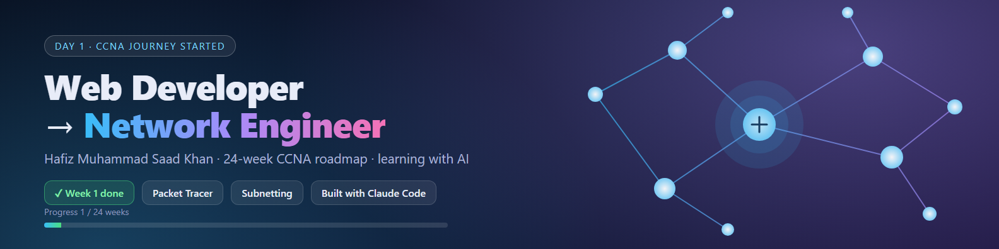

# CCNA in 24 Weeks: Web Developer → Network Engineer

Hafiz Muhammad Saad Khan's public learning log. 24-week CCNA roadmap, labs, and a study website, built with AI (Claude Code).

## Journey

| Week | Topic | Status |
|------|-------|--------|
| 1 | OSI/TCP-IP, first Packet Tracer lab | ✅ Done |
| 2 | IPv4 addressing | ⬜ |
| 3 | Subnetting | ⬜ |
| 4 | Ethernet, switching, Cisco CLI | ⬜ |
| 5-8 | VLANs, inter-VLAN, STP, switch security | ⬜ |
| 9-14 | Static routing, OSPF, DHCP/NAT, IPv6, Project 1 | ⬜ |
| 15-19 | ACLs, VPN, wireless, services, WAN/cloud | ⬜ |
| 20-22 | Python automation, APIs, Wireshark | ⬜ |
| 23-24 | Mock exams, exam booking, job hunt | ⬜ |

## What's inside
- [`site/`](site/index.html): offline study website (24 lessons, quizzes, subnet calculator, drills). Open `site/index.html` in Chrome.
- [`labs/`](labs): Packet Tracer files (`lab01.pkt`)
- `01-roadmap.md`: full week by week plan
- `02-ai-study-system.md`: AI prompts and daily routine
- `03-labs/`: lab instructions
- `05-career-plan.md`: certifications and job plan
- [`assets/`](assets): banner and social card

## Lab 01: first network
1 switch (2960) + 3 PCs, 192.168.1.0/24, ping tested between all hosts.

## Daily routine
15 min revision · 60 min video · 60 min lab · 15 min notes.
